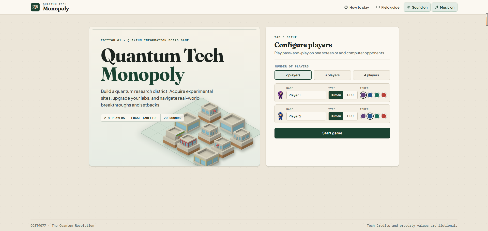
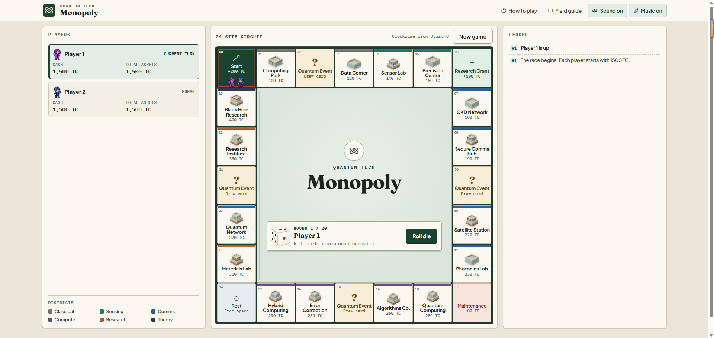

# Quantum Tech Monopoly

This is our game project for CCST9077 - The Quantum Revolution. It is a Monopoly-style board game based on quantum technology. Players buy research sites, upgrade them, and collect rent. There are also event cards that introduce quantum science concepts during the game.

## Screenshots

### Player setup

Choose the number of players, enter their names, select human or computer opponents, and pick token colours before starting the game.



### Game board

The main game screen shows the research sites, player balances and total assets, current turn controls, and a ledger of game events.



## How to run

The game is made with HTML, CSS, and JavaScript. You do not need to install any npm packages to play, but you need a local server to load the game files.

1. Open a terminal in the project folder.
2. If you have Python 3 installed, run:

   ```sh
   python -m http.server 8080
   ```

3. Open [http://localhost:8080](http://localhost:8080) in your browser. Do not open `index.html` directly, because the JavaScript modules and JSON files need to load through the server.

## How to play

- Choose two to four players, with at least one human player. You can play with other people on the same device or add computer players.
- Each player starts with 1,500 Tech Credits (TC). On your turn, roll the die and follow the instructions for the tile you land on. Passing or landing on Start gives you 200 TC.
- You can buy an unowned site, upgrade your own site, or pay rent if someone else owns it.
- If you cannot afford a payment, your sites can be sold at 50% of their book value. If that is still not enough, you pay what you have and leave the game.
- Quantum Events can change rent, give you grants, or ask you to make a choice. You can click on tiles or open the Field guide to learn more about the science and find the sources.
- The last player remaining wins. If the game reaches 20 rounds, the remaining player with the highest total assets wins. Ties are shared. Total assets include cash, property prices, and the cost of upgrades.

On a phone, you can swipe sideways to see the board. Sound and music are off by default, but you can turn them on using the buttons at the top. You can also use Tab to move between controls, Enter or Space to select them, and Escape to close information dialogs. The game follows your system's reduced-motion setting.
